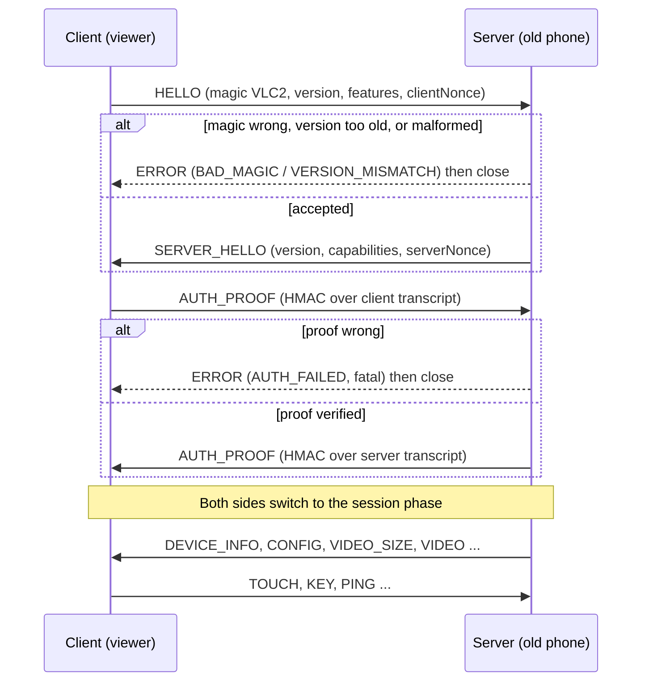
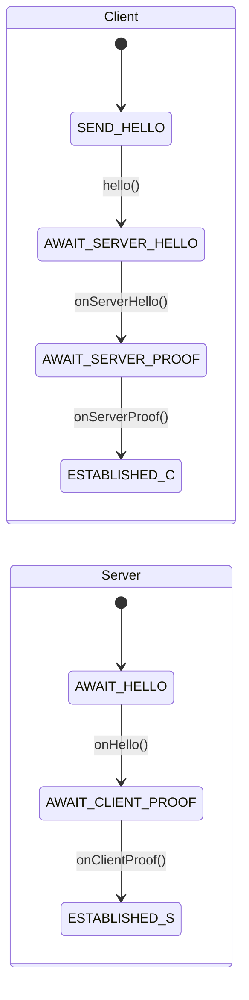

# VeloCast wire protocol v2

Status: S02. This document is the contract between the viewer, the server and every launcher.
The reference implementation is the pure Kotlin/JVM module `:protocol`
(package `com.mastersoft.velocast.protocol`). The tests in `:protocol` parse the tables and the
worked examples in this file and fail when they disagree with the code, so keep both in step.

Closes: CQ-02 (one shared, versioned protocol), SEC-05 (validators), FUN-02 (`KEYFRAME_REQ`),
PERF-08 (`captureUs`, `PONG.serverUs`).

## 1. Conventions

- All integers are big-endian. `u8/u16/u32` are unsigned, `i32/i64` are two's complement,
  `f32` is IEEE 754 binary32.
- Text is UTF-8 without NUL (U+0000). Overlong forms, surrogates and code points above U+10FFFF
  are invalid. A string with a one-byte length prefix is written `str8`.
- Reserved and unused fields MUST be zero when sent and are rejected when not (canonical
  encoding; a float field that must be zero must be the bit pattern `0x00000000`).
- The connection is one TCP byte stream per direction. There are two framings:
  server to client (S to C) uses a 24-byte frame header, client to server (C to S) uses a 16-byte
  control packet. Both are described below.
- The protocol is an ordinary byte stream protocol. When `Features.SECURE_CHANNEL` (`0x20`) is
  negotiated (mandatory for production sessions in step `S06`), every post-handshake `Phase.SESSION`
  frame or control packet is wrapped in an `AES-256-GCM` record with a 16-byte authenticated header
  and 96-bit directional counter nonce; see [security.md](security.md) for the full AEAD record
  layout and HKDF-SHA256 key schedule.
- After any protocol violation the receiver closes the connection. It must not try to resynchronise.

### 1.1 Limits

<!-- begin:limits -->
| Name | Value | Meaning |
| --- | --- | --- |
| `DEFAULT_PORT` | 27183 | Default TCP port. |
| `VERSION` | 2 | Highest protocol version implemented. |
| `FRAME_HEADER_SIZE` | 24 | S to C frame header. |
| `CONTROL_PACKET_SIZE` | 16 | C to S control packet. |
| `HELLO_SIZE` | 26 | HELLO payload. |
| `SERVER_HELLO_SIZE` | 22 | SERVER_HELLO payload. |
| `DEVICE_INFO_MIN_SIZE` | 10 | Smallest DEVICE_INFO payload (empty strings). |
| `DEVICE_INFO_MAX_SIZE` | 106 | Largest DEVICE_INFO payload (48-byte strings). |
| `MAX_PAYLOAD` | 4194304 | Largest S to C payload (4 MiB). |
| `MAX_CONTROL_PAYLOAD` | 262144 | Largest payload after a control packet (256 KiB). |
| `MAX_HANDSHAKE_PAYLOAD` | 256 | Payload cap in both directions until the handshake is established. |
| `MAX_TEXT_BYTES` | 4096 | TEXT payload. |
| `MAX_CLIPBOARD_BYTES` | 262144 | CLIPBOARD payload including its flag byte. |
| `MAX_NAME_BYTES` | 48 | Manufacturer and model strings. |
| `MAX_STATUS_DETAIL_BYTES` | 96 | STATUS detail string. |
| `MAX_ERROR_DETAIL_BYTES` | 160 | ERROR detail string. |
| `MAX_POINTER_ID` | 31 | Pointer ids are 0..31. |
| `MIN_BITRATE_BPS` | 1000000 | 1 Mbps. |
| `MAX_BITRATE_BPS` | 40000000 | 40 Mbps. |
| `MIN_FPS` | 15 | Frames per second. |
| `MAX_FPS` | 120 | Frames per second. |
| `MAX_DIMENSION` | 16384 | Pixels per side in VIDEO_SIZE and device info. |
<!-- end:limits -->

Scale is a float in 0.5 to 1.0 (see `CONFIG_STREAM`). Coordinates are floats in 0.0 to 1.0.

## 2. Framing

### 2.1 Server to client frame (24 bytes + payload)

| Offset | Size | Field | Meaning |
| --- | --- | --- | --- |
| 0 | 1 | `type` | Message type (section 2.3). |
| 1 | 1 | `flags` | Bit set from the flag table. Bits 4..7 are reserved and must be zero. |
| 2 | 2 | `seq` | Sequence number, wraps at 65535 (section 5). |
| 4 | 4 | `length` | Payload length in bytes, 0 to 4 MiB; the per-type limits of section 3 apply. |
| 8 | 8 | `ptsUs` | Presentation time of a VIDEO frame in microseconds (i64, not negative). Zero for all other types. |
| 16 | 8 | `captureUs` | Capture time of a VIDEO frame in microseconds on the server's monotonic clock (i64, not negative). Zero for all other types. |

The payload (`length` bytes) follows the header immediately. A `length` with the top bit set
(more than 2 GiB) is rejected like any other length above the limit.

Flags:

<!-- begin:flags -->
| Bit | Name | Rules |
| --- | --- | --- |
| 0x01 | `KEYFRAME` | Only on VIDEO. The frame is a sync (IDR) frame. |
| 0x02 | `CONFIG` | Required on CONFIG and allowed on nothing else. |
| 0x04 | `RESET` | Only on VIDEO, CONFIG and VIDEO_SIZE. The decoder must be flushed and restarted at this frame. On VIDEO it requires `KEYFRAME`. |
| 0x08 | `ERROR` | Required on ERROR and allowed on nothing else. |
<!-- end:flags -->

### 2.2 Client to server control packet (16 bytes, optional payload)

| Offset | Size | Field | Meaning |
| --- | --- | --- | --- |
| 0 | 1 | `type` | Message type. |
| 1 | 1 | `pointer` | Pointer id for TOUCH, key action for KEY, zero otherwise. |
| 2 | 2 | `seq` | Sequence number, wraps at 65535. |
| 4 | 4 | `param` | i32, meaning depends on `type` (table below). For the types HELLO, AUTH_PROOF, TEXT and CLIPBOARD it is the length of the payload that follows the packet. |
| 8 | 4 | `x` | f32, meaning depends on `type`. |
| 12 | 4 | `y` | f32, meaning depends on `type`. |

What each type puts in the fields (a field marked 0 must be zero):

| Type | `pointer` | `param` | `x` | `y` | Payload |
| --- | --- | --- | --- | --- | --- |
| `TOUCH` | pointer id 0..31 | touch action | 0.0..1.0 | 0.0..1.0 | none |
| `KEY` | key action | key code (allow-list) | 0 | 0 | none |
| `TEXT` | 0 | payload length 1..4096 | 0 | 0 | UTF-8 text |
| `CONFIG_STREAM` | 0 | bitrate in bits per second | fps (whole number) | scale | none |
| `KEYFRAME_REQ` | 0 | 0 | 0 | 0 | none |
| `PAUSE` | 0 | 0 | 0 | 0 | none |
| `RESUME` | 0 | 0 | 0 | 0 | none |
| `ACTION` | 0 | device action | 0 | 0 | none |
| `PING` | 0 | token (any i32) | 0 | 0 | none |
| `BYE` | 0 | 0 for a normal close, else an error code id | 0 | 0 | none |
| `CLIPBOARD` | 0 | payload length 1..262144 | 0 | 0 | flags u8 + UTF-8 text |
| `HELLO` | 0 | 26 | 0 | 0 | HELLO payload |
| `AUTH_PROOF` | 0 | 32 | 0 | 0 | proof |

### 2.3 Message types

Ids are unique across both directions. `c2s` means the client may send it, `s2c` the server,
`both` either side (with the layout given for each direction).

<!-- begin:message-types -->
| Id | Name | Direction | Phase | Purpose |
| --- | --- | --- | --- | --- |
| 0x01 | `HELLO` | c2s | handshake | Opens the handshake: magic, version, wanted features, client nonce. |
| 0x02 | `SERVER_HELLO` | s2c | handshake | Version, capabilities, server nonce. |
| 0x03 | `AUTH_PROOF` | both | handshake | HMAC-SHA256 proof over the transcript, client first, then server. |
| 0x04 | `BYE` | both | any | Orderly close, optionally with a reason. |
| 0x05 | `PING` | c2s | session | Liveness and round-trip probe. |
| 0x06 | `PONG` | s2c | session | Answers PING and carries the server clock. |
| 0x10 | `VIDEO` | s2c | session | One encoded video access unit. |
| 0x11 | `CONFIG` | s2c | session | Codec and codec-specific data (SPS/PPS). |
| 0x12 | `VIDEO_SIZE` | s2c | session | Stream size and display geometry. |
| 0x13 | `STATUS` | s2c | session | Typed state change. |
| 0x14 | `ERROR` | s2c | any | Typed failure report. |
| 0x15 | `CLIPBOARD` | both | session | Clipboard text. |
| 0x16 | `DEVICE_INFO` | s2c | session | Android API level, launch mode, display geometry, manufacturer and model. |
| 0x20 | `TOUCH` | c2s | session | One pointer event. |
| 0x21 | `KEY` | c2s | session | One key event from the allow-list. |
| 0x22 | `TEXT` | c2s | session | Text to type. |
| 0x23 | `CONFIG_STREAM` | c2s | session | Bitrate, fps and scale of the stream. |
| 0x24 | `KEYFRAME_REQ` | c2s | session | Ask for an IDR frame (FUN-02). |
| 0x25 | `PAUSE` | c2s | session | Stop encoding (viewer in the background). |
| 0x26 | `RESUME` | c2s | session | Resume; the server then sends a keyframe. |
| 0x27 | `ACTION` | c2s | session | Shade, rotate, display power, wake, back, home, recents. |
<!-- end:message-types -->

Phase rules: in the handshake phase only the types marked `handshake` and `any` are accepted and
every payload is capped at 256 bytes. In the session phase the `handshake` types are rejected.
A reader or writer starts in the handshake phase and is switched to the session phase by its
owner once the handshake is established, so nothing but HELLO, SERVER_HELLO, AUTH_PROOF, ERROR
and BYE can be parsed or produced before authentication succeeded (SEC-01).

Enumerations used in the fields:

<!-- begin:touch-actions -->
| Id | Name | Meaning |
| --- | --- | --- |
| 0 | `DOWN` | Pointer touches the screen. Only valid when that pointer is up. |
| 1 | `UP` | Pointer lifts. Only valid when that pointer is down. |
| 2 | `MOVE` | Pointer moves. Only valid when that pointer is down. |
| 3 | `CANCEL` | Cancels every pointer. |
<!-- end:touch-actions -->

<!-- begin:key-actions -->
| Id | Name | Meaning |
| --- | --- | --- |
| 0 | `DOWN` | Key goes down. |
| 1 | `UP` | Key comes up. |
<!-- end:key-actions -->

<!-- begin:device-actions -->
| Id | Name | Meaning |
| --- | --- | --- |
| 1 | `EXPAND_SHADE` | Pull down the notification shade. |
| 2 | `COLLAPSE_SHADE` | Collapse the shade and quick settings. |
| 3 | `ROTATE` | Rotate the display one quarter turn. |
| 4 | `DISPLAY_POWER_ON` | Switch the panel on (capture keeps running). |
| 5 | `DISPLAY_POWER_OFF` | Switch the panel off while mirroring (capture keeps running). |
| 6 | `WAKE` | Wake the device. |
| 7 | `BACK` | Global back. |
| 8 | `HOME` | Global home. |
| 9 | `RECENTS` | Global recents. |
<!-- end:device-actions -->

## 3. Payloads

Offsets are relative to the start of the payload. "Size" is in bytes.

### 3.1 HELLO (c2s, 26 bytes)

| Offset | Size | Field | Meaning |
| --- | --- | --- | --- |
| 0 | 4 | `magic` | ASCII `VLC2` (`56 4C 43 32`). Anything else is `BAD_MAGIC`. |
| 4 | 2 | `version` | Highest protocol version the client speaks. |
| 6 | 4 | `features` | Bitmap of features the client wants (section 6.3). |
| 10 | 16 | `clientNonce` | Fresh random bytes for this connection. |

### 3.2 SERVER_HELLO (s2c, 22 bytes)

| Offset | Size | Field | Meaning |
| --- | --- | --- | --- |
| 0 | 2 | `version` | The negotiated version: the lower of the two sides' versions. |
| 2 | 4 | `capabilities` | Bitmap of features the server offers. |
| 6 | 16 | `serverNonce` | Fresh random bytes for this connection. |

No device-identifying information is included in `SERVER_HELLO`; the server sends `DEVICE_INFO`
only after `AUTH_PROOF` verification succeeds (section 3.12, section 6.4).

### 3.3 AUTH_PROOF (both directions, 32 bytes)

| Offset | Size | Field | Meaning |
| --- | --- | --- | --- |
| 0 | 32 | `proof` | HMAC-SHA256 over the handshake transcript (section 6.2). |

### 3.4 BYE

C to S: no payload; `param` is 0 for a normal close or an error code id from section 8.
S to C (2 bytes): `code` u16, 0 for a normal close or an error code id.

### 3.5 PING and PONG

PING has no payload; `param` is a token chosen by the client. PONG (s2c, 12 bytes):

| Offset | Size | Field | Meaning |
| --- | --- | --- | --- |
| 0 | 4 | `token` | The token of the PING being answered. |
| 4 | 8 | `serverUs` | The server's monotonic clock in microseconds when it answered (i64, not negative). |

The server must answer a PING at once, ahead of queued video (PERF-01). The server also sends a
frame or a PONG at least every 2 s while a session is active, so a client may treat 6 s of
silence as a lost link (FUN-03, `LINK_LOST`).

### 3.6 VIDEO (s2c, 1 byte to 4 MiB)

The payload is one encoded access unit (H.264 or H.265 in Annex B form, as produced by
MediaCodec). The header carries `ptsUs` and `captureUs`. Flags: `KEYFRAME` on sync frames,
`RESET` (together with `KEYFRAME`) when the decoder must restart. The server sends a keyframe
first after CONFIG, after RESUME, after every `KEYFRAME_REQ` and after a size change.

### 3.7 CONFIG (s2c, 2 bytes to 4 MiB)

| Offset | Size | Field | Meaning |
| --- | --- | --- | --- |
| 0 | 1 | `codec` | Codec id (table below). |
| 1 | n | `csd` | Codec-specific data (SPS/PPS, or VPS/SPS/PPS), at least 1 byte. |

The header must carry the `CONFIG` flag and may carry `RESET`.

<!-- begin:codecs -->
| Id | Name | Meaning |
| --- | --- | --- |
| 1 | `H264` | H.264 / AVC. |
| 2 | `H265` | H.265 / HEVC. Only when both sides set the `HEVC` feature. |
<!-- end:codecs -->

### 3.8 VIDEO_SIZE (s2c, 9 bytes)

| Offset | Size | Field | Meaning |
| --- | --- | --- | --- |
| 0 | 2 | `streamWidth` | Width of the encoded stream in pixels, 1..16384. |
| 2 | 2 | `streamHeight` | Height of the encoded stream in pixels, 1..16384. |
| 4 | 2 | `displayWidth` | Physical display width in pixels. |
| 6 | 2 | `displayHeight` | Physical display height in pixels. |
| 8 | 1 | `rotation` | Display rotation in quarter turns, 0..3. |

Sent right after CONFIG and again whenever the stream size, the display size or the rotation
changes (FUN-01). It carries the `RESET` flag. Touch coordinates are normalised to the display,
and the server maps them with the geometry it last announced.

### 3.9 STATUS (s2c, 6 to 102 bytes)

| Offset | Size | Field | Meaning |
| --- | --- | --- | --- |
| 0 | 1 | `kind` | Status kind (table below). |
| 1 | 4 | `value` | i32 value, legal range depends on the kind. |
| 5 | 1+n | `detail` | `str8`, at most 96 bytes, may be empty. |

<!-- begin:status-kinds -->
| Id | Name | Value |
| --- | --- | --- |
| 1 | `DISPLAY_POWER` | 1 panel on, 0 panel off. |
| 2 | `SCREEN_LOCKED` | 1 locked, 0 unlocked. |
| 3 | `ROTATION` | Rotation in quarter turns, 0..3. |
| 4 | `PAUSED` | 1 paused, 0 running. |
| 5 | `BITRATE` | Bitrate now in use in bits per second, at least 0. |
| 6 | `FPS` | Frame rate now in use, at least 0. |
| 7 | `DROPPED_FRAMES` | Frames dropped by the server since the last report, at least 0. |
| 8 | `DEGRADED` | A capability is degraded; value is a feature bit index, `detail` names it. |
<!-- end:status-kinds -->

### 3.10 ERROR (s2c, 4 to 164 bytes)

| Offset | Size | Field | Meaning |
| --- | --- | --- | --- |
| 0 | 2 | `code` | Error code id (section 8). |
| 2 | 1 | `fatal` | 1 when the session ends after this message, 0 otherwise. |
| 3 | 1+n | `detail` | `str8`, at most 160 bytes, may be empty. Never contains secrets. |

The header must carry the `ERROR` flag.

### 3.11 CLIPBOARD (both directions)

S to C: the frame payload (1 byte to 256 KiB). C to S: the control packet's `param` is the payload
length (1 byte to 256 KiB). Payload layout in both directions:

| Offset | Size | Field | Meaning |
| --- | --- | --- | --- |
| 0 | 1 | `flags` | Bit 0: paste after setting the clipboard (honoured only from the client). Other bits must be zero. |
| 1 | n | `text` | UTF-8 text, may be empty. |

### 3.12 DEVICE_INFO (s2c, 10 to 106 bytes)

Sent in the session phase after authentication succeeds, so unauthenticated peers learn nothing
about the old phone (R10).

| Offset | Size | Field | Meaning |
| --- | --- | --- | --- |
| 0 | 2 | `sdkInt` | Android API level of the device (`u16`). |
| 2 | 1 | `launchMode` | How the server runs (table below). |
| 3 | 2 | `displayWidth` | Physical display width in pixels, 1..16384. |
| 5 | 2 | `displayHeight` | Physical display height in pixels, 1..16384. |
| 7 | 1 | `rotation` | Display rotation in quarter turns, 0..3. |
| 8 | 1+n | `manufacturer` | `str8`, at most 48 bytes. |
| next | 1+n | `model` | `str8`, at most 48 bytes. |

<!-- begin:launch-modes -->
| Id | Name | Meaning |
| --- | --- | --- |
| 0 | `UNKNOWN` | Not reported. |
| 1 | `SHELL` | Running as the shell user (uid 2000). |
| 2 | `ROOT` | Running as root. |
<!-- end:launch-modes -->

### 3.13 TEXT (c2s)

The payload is the UTF-8 text to type (1 to 4096 bytes); `param` is its length.

### 3.14 CONFIG_STREAM (c2s)

`param` is the bitrate in bits per second (1,000,000 to 40,000,000), `x` the frame rate as a
whole number between 15 and 120, `y` the resolution scale between 0.5 and 1.0. All three are
always present. The server answers with STATUS (`BITRATE`, `FPS`) and, if the stream size
changes, with CONFIG and VIDEO_SIZE.

## 4. Validation rules

Every violation raises `ProtocolException` with the code shown; nothing else is ever thrown for
bad input. Validation happens in the readers before any value is used, and in the writers before
any byte is written.

| Rule | Code |
| --- | --- |
| Unknown type id | `UNKNOWN_MESSAGE_TYPE` |
| Type not valid in this direction or phase | `UNEXPECTED_MESSAGE` |
| Payload longer than the limit for the type, phase or reader | `MESSAGE_TOO_LARGE` (checked before the payload is read) |
| Payload shorter than the minimum, reserved or unused field not zero, bad flag combination, trailing bytes | `MALFORMED_MESSAGE` |
| Stream ends inside a message | `TRUNCATED` |
| Pointer id outside 0..31 | `INVALID_POINTER` |
| Coordinate not finite or outside [0, 1] | `INVALID_COORDINATE` |
| Key code not in the allow-list | `KEY_NOT_ALLOWED` |
| Bitrate outside 1..40 Mbps, fps outside 15..120 or not whole, scale outside 0.5..1.0, unknown action or enum id, rotation outside 0..3, size outside 1..16384, negative timestamp | `VALUE_OUT_OF_RANGE` |
| Text not valid UTF-8 or containing NUL | `INVALID_TEXT` |
| `HELLO` magic is not `VLC2` | `BAD_MAGIC` |
| Proof does not verify | `AUTH_FAILED` |
| `DOWN`, `MOVE` or `UP` that does not fit the pointer's state (`PointerStateTracker`) | `INVALID_POINTER_STATE` |

A clean end of stream exactly between two messages is not an error: the readers return `false`.
I/O errors of the stream itself (timeouts, resets) are `IOException`s, not protocol violations.

### 4.1 Key allow-list

Key codes are the Android `KeyEvent.KEYCODE_*` values. Only these are accepted; everything else,
including CALL (5) and ENDCALL (6), is `KEY_NOT_ALLOWED`. POWER is on the list because the Screen
off and Wake buttons need it.

<!-- begin:key-codes -->
| Code | Name |
| --- | --- |
| 3 | `HOME` |
| 4 | `BACK` |
| 7 | `KEY_0` |
| 8 | `KEY_1` |
| 9 | `KEY_2` |
| 10 | `KEY_3` |
| 11 | `KEY_4` |
| 12 | `KEY_5` |
| 13 | `KEY_6` |
| 14 | `KEY_7` |
| 15 | `KEY_8` |
| 16 | `KEY_9` |
| 17 | `STAR` |
| 18 | `POUND` |
| 19 | `DPAD_UP` |
| 20 | `DPAD_DOWN` |
| 21 | `DPAD_LEFT` |
| 22 | `DPAD_RIGHT` |
| 23 | `DPAD_CENTER` |
| 24 | `VOLUME_UP` |
| 25 | `VOLUME_DOWN` |
| 26 | `POWER` |
| 29 | `KEY_A` |
| 30 | `KEY_B` |
| 31 | `KEY_C` |
| 32 | `KEY_D` |
| 33 | `KEY_E` |
| 34 | `KEY_F` |
| 35 | `KEY_G` |
| 36 | `KEY_H` |
| 37 | `KEY_I` |
| 38 | `KEY_J` |
| 39 | `KEY_K` |
| 40 | `KEY_L` |
| 41 | `KEY_M` |
| 42 | `KEY_N` |
| 43 | `KEY_O` |
| 44 | `KEY_P` |
| 45 | `KEY_Q` |
| 46 | `KEY_R` |
| 47 | `KEY_S` |
| 48 | `KEY_T` |
| 49 | `KEY_U` |
| 50 | `KEY_V` |
| 51 | `KEY_W` |
| 52 | `KEY_X` |
| 53 | `KEY_Y` |
| 54 | `KEY_Z` |
| 55 | `COMMA` |
| 56 | `PERIOD` |
| 61 | `TAB` |
| 62 | `SPACE` |
| 66 | `ENTER` |
| 67 | `DEL` |
| 68 | `GRAVE` |
| 69 | `MINUS` |
| 70 | `EQUALS` |
| 71 | `LEFT_BRACKET` |
| 72 | `RIGHT_BRACKET` |
| 73 | `BACKSLASH` |
| 74 | `SEMICOLON` |
| 75 | `APOSTROPHE` |
| 76 | `SLASH` |
| 77 | `AT` |
| 81 | `PLUS` |
| 92 | `PAGE_UP` |
| 93 | `PAGE_DOWN` |
| 111 | `ESCAPE` |
| 112 | `FORWARD_DEL` |
| 122 | `MOVE_HOME` |
| 123 | `MOVE_END` |
| 187 | `APP_SWITCH` |
| 224 | `WAKEUP` |
<!-- end:key-codes -->

## 5. Sequence numbers, timestamps and clocks

- `seq` is a 16-bit counter per direction. For VIDEO and CONFIG it counts every encoded frame the
  server produced, including frames its latest-wins queue dropped before sending. A gap in the
  VIDEO sequence therefore means frames were skipped: the client discards until the next keyframe
  and sends `KEYFRAME_REQ` (FUN-02). `SeqTracker.onSeq` returns the size of the gap and rejects
  a sequence that goes backwards. For all other types `seq` is a plain per-sender counter used
  for diagnostics only.
- `ptsUs` is the media timestamp for the decoder. `captureUs` is when the frame was captured, on
  the server's monotonic clock in microseconds.
- Clock offset (PERF-08): the client records its own monotonic time `t0` when it sends a PING and
  `t1` when the PONG arrives. With `serverUs` from the PONG, `offset = serverUs - (t0 + t1) / 2`
  and the end-to-end latency of a frame is `clientNow - (captureUs - offset)`. The client keeps
  the sample with the smallest round trip.

## 6. Handshake

### 6.1 Sequence



State machines of the two `Handshake` classes (`FAILED` is entered on any error or
out-of-order message and is final):



### 6.2 Transcript and proofs

A proof is `HMAC-SHA256(authKey, SHA-256(transcript))` in production (`HkdfAuthenticator`, step
`S06`), where `authKey` is derived via `HKDF-SHA256` from the shared secret and both nonces; see
[security.md](security.md). The protocol state machine interacts with proofs through the interface:

```kotlin
interface Authenticator {
    fun computeProof(transcript: ByteArray): ByteArray            // 32 bytes
    fun verifyProof(transcript: ByteArray, proof: ByteArray): Boolean  // constant time
}
```

The transcript is the concatenation of:

1. a 17-byte ASCII label: `VLC2 client proof` for the client's proof, `VLC2 server proof` for
   the server's (so a proof cannot be reflected),
2. the exact 26-byte HELLO payload,
3. the exact 22-byte SERVER_HELLO payload.

Both nonces and everything that was offered and negotiated are covered, so tampering with
HELLO or SERVER_HELLO in transit makes the proofs fail. The worked example in section 9 lists the
transcript and both proofs for a fixed key (`HmacTestAuthenticator` in the test fixtures is a
test double built on the JDK's HMAC; the production authenticator is S06).

### 6.3 Negotiation and features

- Version: the server answers with `min(client version, 2)`. A client version below 2 is
  `VERSION_MISMATCH`. The client rejects a SERVER_HELLO whose version is below 2 or above its own.
- Features: the usable set is `HELLO.features AND SERVER_HELLO.capabilities`. Unknown bits are
  ignored.

| Bit | Mask | Name | Meaning |
| --- | --- | --- | --- |
| 0 | 0x01 | `HEVC` | H.265 can be used. |
| 1 | 0x02 | `CLIPBOARD` | CLIPBOARD messages are supported. |
| 2 | 0x04 | `TEXT_INPUT` | TEXT messages are supported. |
| 3 | 0x08 | `DISPLAY_POWER` | `DISPLAY_POWER_ON/OFF` actions are supported. |
| 4 | 0x10 | `ROTATION_EVENTS` | The server pushes VIDEO_SIZE on rotation. |
| 5 | 0x20 | `SECURE_CHANNEL` | Reserved for the encrypted record layer (S06). |

### 6.4 Before authentication

- The server sends nothing except SERVER_HELLO, ERROR and BYE until the client's proof verified;
  it accepts nothing except HELLO, AUTH_PROOF and BYE, and no payload above 256 bytes.
- A failed attempt must not disturb an active session: the server authenticates a new
  connection before it considers pre-empting the old one (SEC-03).
- No device data before authentication (R10): `SERVER_HELLO` carries only the negotiated version,
  server capability bitmap and `serverNonce` (22 bytes). Static device metadata (`sdkInt`,
  `launchMode`, display geometry, `manufacturer` and `model`) is sent only after `AUTH_PROOF`
  verification succeeds via `DEVICE_INFO` (`0x16`, `SESSION_ONLY`).

## 7. Using the library

- `FrameReader`, `FrameWriter`, `ControlReader`, `ControlWriter` work on `InputStream` and
  `OutputStream`. They are not thread-safe: one reader and one writer per connection, calls
  serialised by the owner.
- Reusable objects: `FrameHeader` and `ControlPacket` are filled in place, readers reuse one
  internal buffer, and `FrameReader.readPayload(header, dest, offset)` reads video straight into
  a caller-owned (pooled) buffer. `FrameWriter.writeInPlace` writes the header in front of a
  payload that is already in place and sends the whole frame with one `write`. The tests assert
  that reading and writing TOUCH, KEY, PING and VIDEO frames allocates nothing per message.
- Memory is bounded: a declared length is checked against the limit before any payload byte is
  read, and the internal buffer grows only as bytes really arrive, so a peer that announces 4 MiB
  and sends nothing costs a few KiB. Each reader takes a `maxPayload` to cap it further.
- `Phase` is set by the owner: `reader.phase = Phase.SESSION` after `ESTABLISHED`.
- Typed payloads (`Hello`, `ServerHello`, `AuthProof`, `DeviceInfo`, `VideoSize`, `CodecConfig`,
  `Status`, `ErrorMessage`, `Pong`, `Bye`, `ClipboardMessage`, `TextInput`) validate on
  construction, so a decoded object is always valid and always encodes to a legal payload.
- `PointerStateTracker` and `SeqTracker` are small helpers for the receiving side (section 4, 5).

## 8. Error codes

Ids 1 to 11 are the user-facing catalogue of `docs/product-requirements.md` (same names and
order; that file holds the message text and the primary fix). Ids from 100 are protocol
violations raised by this library. Both kinds can travel in ERROR and BYE.

<!-- begin:error-codes -->
| Id | Name | Meaning |
| --- | --- | --- |
| 1 | `DEBUGGING_OFF` | USB or Wireless debugging is off on the old phone. |
| 2 | `WIRELESS_OFF_AFTER_REBOOT` | The old phone restarted, so wireless debugging switched off. |
| 3 | `DIFFERENT_NETWORK` | The two phones are on different Wi-Fi networks. |
| 4 | `AUTH_EXPIRED` | This viewer's authorisation expired (7-day rule). |
| 5 | `NOT_PAIRED` | This viewer is not paired with that phone. |
| 6 | `SERVER_START_FAILED` | The mirror service could not start. |
| 7 | `INJECTION_DENIED` | This phone blocks touch control from debugging. |
| 8 | `SCREEN_OFF` | The old phone's screen is off. |
| 9 | `LOCKED` | The old phone is locked. |
| 10 | `VERSION_MISMATCH` | The viewer and the mirror service are different versions. |
| 11 | `LINK_LOST` | The connection was lost. |
| 100 | `MALFORMED_MESSAGE` | Wrong length, non-zero reserved field, bad flags or trailing bytes. |
| 101 | `UNKNOWN_MESSAGE_TYPE` | The type id is not defined. |
| 102 | `UNEXPECTED_MESSAGE` | Wrong direction, wrong phase or out-of-order handshake message. |
| 103 | `MESSAGE_TOO_LARGE` | A length or text exceeds its limit. |
| 104 | `TRUNCATED` | The stream ended inside a message. |
| 105 | `BAD_MAGIC` | HELLO does not start with `VLC2`. |
| 106 | `AUTH_FAILED` | A handshake proof did not verify. |
| 107 | `INVALID_POINTER` | Pointer id outside 0..31. |
| 108 | `INVALID_COORDINATE` | Coordinate not finite or outside [0, 1]. |
| 109 | `KEY_NOT_ALLOWED` | Key code not in the allow-list. |
| 110 | `VALUE_OUT_OF_RANGE` | A numeric field or enum id is outside its range. |
| 111 | `INVALID_POINTER_STATE` | Touch action does not fit the pointer's state. |
| 112 | `INVALID_TEXT` | Text is not valid UTF-8 or contains NUL. |
<!-- end:error-codes -->

## 9. Worked examples

Every block below is a complete message as it appears on the wire (hex, bytes separated for
reading only) followed by the decoded form after `=`. The tests decode each block with the
real readers, compare the result with the `=` line, write the message again with the real
writers and compare the bytes. They are also stored as golden vectors
(`protocol/src/test/resources/golden-vectors.txt`), which were produced by an independent
Python encoder. Floats: `3F000000` is 0.5, `3E800000` is 0.25, `3F800000` is 1.0,
`3F400000` is 0.75, `42700000` is 60.0.

### 9.1 Client to server

<!-- vector touch-down c2s session -->
`touch-down` (session phase)

```text
20 00 00 01 00 00 00 00 3F 00 00 00 3E 80 00 00
= TOUCH seq=1 pointer=0 param=0 x=0.5 y=0.25
```

<!-- vector touch-move-pointer-1 c2s session -->
`touch-move-pointer-1` (session phase)

```text
20 01 00 02 00 00 00 02 3F 40 00 00 3F 80 00 00
= TOUCH seq=2 pointer=1 param=2 x=0.75 y=1.0
```

<!-- vector touch-up c2s session -->
`touch-up` (session phase)

```text
20 00 00 03 00 00 00 01 3F 00 00 00 3E 80 00 00
= TOUCH seq=3 pointer=0 param=1 x=0.5 y=0.25
```

<!-- vector touch-cancel-pointer-31 c2s session -->
`touch-cancel-pointer-31` (session phase)

```text
20 1F 00 04 00 00 00 03 00 00 00 00 00 00 00 00
= TOUCH seq=4 pointer=31 param=3 x=0.0 y=0.0
```

<!-- vector key-back-down c2s session -->
`key-back-down` (session phase)

```text
21 00 00 05 00 00 00 04 00 00 00 00 00 00 00 00
= KEY seq=5 pointer=0 param=4 x=0.0 y=0.0
```

<!-- vector key-enter-up c2s session -->
`key-enter-up` (session phase)

```text
21 01 00 06 00 00 00 42 00 00 00 00 00 00 00 00
= KEY seq=6 pointer=1 param=66 x=0.0 y=0.0
```

<!-- vector config-stream c2s session -->
`config-stream` (session phase)

```text
23 00 00 07 00 7A 12 00 42 70 00 00 3F 40 00 00
= CONFIG_STREAM seq=7 pointer=0 param=8000000 x=60.0 y=0.75
```

<!-- vector keyframe-req c2s session -->
`keyframe-req` (session phase)

```text
24 00 00 08 00 00 00 00 00 00 00 00 00 00 00 00
= KEYFRAME_REQ seq=8 pointer=0 param=0 x=0.0 y=0.0
```

<!-- vector pause c2s session -->
`pause` (session phase)

```text
25 00 00 09 00 00 00 00 00 00 00 00 00 00 00 00
= PAUSE seq=9 pointer=0 param=0 x=0.0 y=0.0
```

<!-- vector resume c2s session -->
`resume` (session phase)

```text
26 00 00 0A 00 00 00 00 00 00 00 00 00 00 00 00
= RESUME seq=10 pointer=0 param=0 x=0.0 y=0.0
```

<!-- vector action-rotate c2s session -->
`action-rotate` (session phase)

```text
27 00 00 0B 00 00 00 03 00 00 00 00 00 00 00 00
= ACTION seq=11 pointer=0 param=3 x=0.0 y=0.0
```

<!-- vector ping c2s session -->
`ping` (session phase)

```text
05 00 00 0C 01 02 03 04 00 00 00 00 00 00 00 00
= PING seq=12 pointer=0 param=16909060 x=0.0 y=0.0
```

<!-- vector bye-normal c2s session -->
`bye-normal` (session phase)

```text
04 00 00 0D 00 00 00 00 00 00 00 00 00 00 00 00
= BYE seq=13 pointer=0 param=0 x=0.0 y=0.0
```

<!-- vector bye-link-lost c2s session -->
`bye-link-lost` (session phase)

```text
04 00 00 0E 00 00 00 0B 00 00 00 00 00 00 00 00
= BYE seq=14 pointer=0 param=11 x=0.0 y=0.0
```

<!-- vector text-hi c2s session -->
`text-hi` (session phase)

```text
22 00 00 0F 00 00 00 02 00 00 00 00 00 00 00 00
48 69
= TEXT seq=15 text="Hi"
```

<!-- vector clipboard-paste c2s session -->
`clipboard-paste` (session phase)

```text
15 00 00 10 00 00 00 03 00 00 00 00 00 00 00 00
01 6F 6B
= CLIPBOARD seq=16 paste=true text="ok"
```

<!-- vector hello c2s handshake -->
`hello` (handshake phase)

```text
01 00 00 00 00 00 00 1A 00 00 00 00 00 00 00 00
56 4C 43 32 00 02 00 00 00 03 00 01 02 03 04 05
06 07 08 09 0A 0B 0C 0D 0E 0F
= HELLO seq=0 version=2 features=0x3 nonce=000102030405060708090a0b0c0d0e0f
```

<!-- vector auth-proof-client c2s handshake -->
`auth-proof-client` (handshake phase)

```text
03 00 00 01 00 00 00 20 00 00 00 00 00 00 00 00
A0 A1 A2 A3 A4 A5 A6 A7 A8 A9 AA AB AC AD AE AF
B0 B1 B2 B3 B4 B5 B6 B7 B8 B9 BA BB BC BD BE BF
= AUTH_PROOF seq=1 proof=a0a1a2a3a4a5a6a7a8a9aaabacadaeafb0b1b2b3b4b5b6b7b8b9babbbcbdbebf
```

### 9.2 Server to client

<!-- vector video-keyframe s2c session -->
`video-keyframe` (session phase)

```text
10 01 00 07 00 00 00 04 00 00 00 00 00 0F 42 40 00 00 00 00 00 0F 3E 58
00 00 00 01
= VIDEO flags=KEYFRAME seq=7 pts=1000000 capture=999000 length=4
```

<!-- vector video-delta s2c session -->
`video-delta` (session phase)

```text
10 00 00 08 00 00 00 03 00 00 00 00 00 0F 83 5B 00 00 00 00 00 0F 7C D8
41 9A 24
= VIDEO flags=none seq=8 pts=1016667 capture=1015000 length=3
```

<!-- vector video-reset-keyframe s2c session -->
`video-reset-keyframe` (session phase)

```text
10 05 00 09 00 00 00 02 00 00 00 00 00 00 00 00 00 00 00 00 00 00 00 00
65 88
= VIDEO flags=KEYFRAME|RESET seq=9 pts=0 capture=0 length=2
```

<!-- vector config-h264 s2c session -->
`config-h264` (session phase)

```text
11 02 00 01 00 00 00 06 00 00 00 00 00 00 00 00 00 00 00 00 00 00 00 00
01 00 00 00 01 67
= CONFIG flags=CONFIG seq=1 pts=0 capture=0 codec=H264 csd=0000000167
```

<!-- vector video-size s2c session -->
`video-size` (session phase)

```text
12 04 00 02 00 00 00 09 00 00 00 00 00 00 00 00 00 00 00 00 00 00 00 00
02 1C 04 B0 04 38 09 60 00
= VIDEO_SIZE flags=RESET seq=2 pts=0 capture=0 stream=540x1200 display=1080x2400 rotation=0
```

<!-- vector status-display-off s2c session -->
`status-display-off` (session phase)

```text
13 00 00 03 00 00 00 06 00 00 00 00 00 00 00 00 00 00 00 00 00 00 00 00
01 00 00 00 00 00
= STATUS flags=none seq=3 pts=0 capture=0 kind=DISPLAY_POWER value=0 detail=""
```

<!-- vector error-locked s2c session -->
`error-locked` (session phase)

```text
14 08 00 04 00 00 00 07 00 00 00 00 00 00 00 00 00 00 00 00 00 00 00 00
00 09 00 03 50 49 4E
= ERROR flags=ERROR seq=4 pts=0 capture=0 code=LOCKED fatal=false detail="PIN"
```

<!-- vector clipboard-server s2c session -->
`clipboard-server` (session phase)

```text
15 00 00 05 00 00 00 03 00 00 00 00 00 00 00 00 00 00 00 00 00 00 00 00
00 6F 6B
= CLIPBOARD flags=none seq=5 pts=0 capture=0 paste=false text="ok"
```

<!-- vector device-info s2c session -->
`device-info` (session phase)

```text
16 00 00 00 00 00 00 10 00 00 00 00 00 00 00 00 00 00 00 00 00 00 00 00
00 23 01 04 38 09 60 00 04 41 63 6D 65 02 58 31
= DEVICE_INFO flags=none seq=0 pts=0 capture=0 sdk=35 launch=SHELL display=1080x2400 rotation=0 manufacturer="Acme" model="X1"
```

<!-- vector pong s2c session -->
`pong` (session phase)

```text
06 00 00 06 00 00 00 0C 00 00 00 00 00 00 00 00 00 00 00 00 00 00 00 00
01 02 03 04 00 00 00 00 00 0F 42 40
= PONG flags=none seq=6 pts=0 capture=0 token=16909060 serverUs=1000000
```

<!-- vector bye-server s2c session -->
`bye-server` (session phase)

```text
04 00 00 07 00 00 00 02 00 00 00 00 00 00 00 00 00 00 00 00 00 00 00 00
00 00
= BYE flags=none seq=7 pts=0 capture=0 code=none
```

<!-- vector server-hello s2c handshake -->
`server-hello` (handshake phase)

```text
02 00 00 00 00 00 00 16 00 00 00 00 00 00 00 00 00 00 00 00 00 00 00 00
00 02 00 00 00 0F 10 11 12 13 14 15 16 17 18 19
1A 1B 1C 1D 1E 1F
= SERVER_HELLO flags=none seq=0 pts=0 capture=0 version=2 capabilities=0xf nonce=101112131415161718191a1b1c1d1e1f
```

<!-- vector auth-proof-server s2c handshake -->
`auth-proof-server` (handshake phase)

```text
03 00 00 01 00 00 00 20 00 00 00 00 00 00 00 00 00 00 00 00 00 00 00 00
C0 C1 C2 C3 C4 C5 C6 C7 C8 C9 CA CB CC CD CE CF
D0 D1 D2 D3 D4 D5 D6 D7 D8 D9 DA DB DC DD DE DF
= AUTH_PROOF flags=none seq=1 pts=0 capture=0 proof=c0c1c2c3c4c5c6c7c8c9cacbcccdcecfd0d1d2d3d4d5d6d7d8d9dadbdcdddedf
```

<!-- vector error-version-mismatch s2c handshake -->
`error-version-mismatch` (handshake phase)

```text
14 08 00 00 00 00 00 04 00 00 00 00 00 00 00 00 00 00 00 00 00 00 00 00
00 0A 01 00
= ERROR flags=ERROR seq=0 pts=0 capture=0 code=VERSION_MISMATCH fatal=true detail=""
```

### 9.3 Handshake with fixed values

Key (32 bytes): `00 01 02 ... 1F`. The client wants features `0x03`, the server offers `0x0F`;
the nonces are `00..0F` (client) and `10..1F` (server).

| Item | Value |
| --- | --- |
| HELLO payload | `564c4332000200000003000102030405060708090a0b0c0d0e0f` |
| SERVER_HELLO payload | `00020000000f101112131415161718191a1b1c1d1e1f` |
| Client transcript | `564c433220636c69656e742070726f6f66` + HELLO payload + SERVER_HELLO payload |
| Server transcript | `564c4332207365727665722070726f6f66` + HELLO payload + SERVER_HELLO payload |
| Client proof | `f629bab91485d9c0ce2e01824b99b569463a4d23b46c178383c11a4747b995af` |
| Server proof | `4fba50d36619a0aa5dde12c113381b632b7fbe713ea023835145ee8a7f77f17a` |
| Negotiated | version 2, features `0x03` |

## 10. Replacing protocol v1

The old unversioned protocol (12-byte video header, 14-byte control packet, no magic) lives in two
copies: `server-core/.../daemon/Protocol.kt` and `app-viewer/.../Protocol.kt`. v2 is not wire
compatible with it (a v1 peer fails at `BAD_MAGIC` or `UNKNOWN_MESSAGE_TYPE`, which is the intended
failure mode). The copies are still used by the app code and are removed in S03 (server) and S04
(viewer) when those steps move to `:protocol`.
