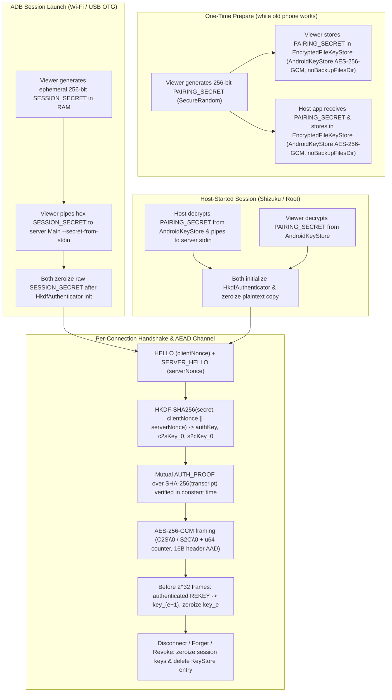

# VeloCast Security Design (`S06`)

Status: `S06`. Closes `SEC-01` (complete) and `SEC-02`.
Reference implementation: `:protocol` (`com.mastersoft.velocast.protocol`), wired into `:server-core` (`SessionGuard`, `ServerSession`, `SessionFrameSink`, `Logger`), `:client-core` (`SessionHandshakeRunner`, `MirrorClient`, `DiagnosticsRingBuffer`, `AndroidKeyStoreSecretStore`), `:app-viewer`, and `:app-host`.

---

## 1. Threat Model

### Assets to protect
1. **Live screen content and clipboard** of the old phone (notifications, messages, photos, banking/2FA codes, lock-screen entry).
2. **Input injection authority** (`TOUCH`, `KEY`, `TEXT`, `CLIPBOARD`, `ACTION` including `WAKE`, `ROTATE`, `EXPAND_SHADE`, and `DISPLAY_POWER_OFF`).
3. **Availability of the rescue session** so an unauthenticated peer on the same Wi-Fi cannot disconnect or starve the owner (`SEC-03`).
4. **Long-term credentials at rest** (`PAIRING_SECRET`, ADB key pair in `S07`, optional Unlock PIN in `S11`).

### Adversaries in scope
- **Passive LAN / Wi-Fi observer**: captures all TCP packets on shared, home, guest, or café Wi-Fi (`SEC-02`). Must learn neither screen pixels, device model/manufacturer, clipboard text, nor typed keys/PIN coordinates.
- **Active on-path or LAN attacker**: connects to TCP port `27183`, replays captured handshakes or session frames, reorders or truncates frames, flips header or ciphertext bits, attempts plaintext downgrade, or floods failed handshakes (`SEC-01`, `SEC-02`, `SEC-03`).
- **Unprivileged local apps on viewer or old phone**: other Android apps (`uid >= 10000`) attempting to read app storage, backups, logs, clipboard diagnostics, or screenshots, or attempting to push a bogus pairing secret.

### Trust boundaries and out-of-scope assumptions
- **Physical / root / ADB shell compromise**: A caller who already holds authorised ADB (`uid 2000`) or `root` (`uid 0`) on the old phone already possesses platform screen-capture and input-injection privileges. VeloCast relies on Android's Wireless/USB Debugging pairing established during `Prepare` (`D3`).
- **`FLAG_SECURE` windows**: Protected windows render black on shell-level virtual displays (`L9`); VeloCast does not bypass `FLAG_SECURE`.
- **Traffic analysis**: Packet timing and approximate frame byte lengths remain observable on TCP (`plaintextLength` in the AEAD header), which is standard for low-latency real-time video transports (comparable to TLS/DTLS/SRTP).

---

## 2. Authentication Modes

VeloCast supports two 256-bit (`32`-byte) secret modes (`AuthMode`), both generated from `java.security.SecureRandom` and using the identical handshake and key schedule:

| Mode | Entropy | Created by | Delivery to server | Persistence | Used when |
| --- | --- | --- | --- | --- | --- |
| `SESSION_SECRET` | 256-bit random | Viewer, fresh per session | Written as a single 64-char hex line to the server's `stdin` (`--secret-from-stdin`) over the authenticated ADB channel | **Memory only** on both phones; zeroized after key setup | Viewer launches `:server-core` over ADB Wi-Fi or USB OTG |
| `PAIRING_SECRET` | 256-bit random | Viewer, once during `Prepare` | Provisioned during `Prepare` to the Host app; piped on `stdin` when the Host app starts `:server-core` | Encrypted at rest via Android Keystore AES-256-GCM in `noBackupFilesDir` on Viewer and Host | Host app starts `:server-core` via Shizuku (`S09`) or root (`S10` / `DaemonController`) |

---

## 3. Handshake and Transcript Proof

### 3.1 Exchange and pre-authentication rules
1. **Client -> Server**: `HELLO` (`26` bytes: magic `"VLC2"`, `clientVersion`, `wantedFeatures` including `Features.SECURE_CHANNEL = 0x20`, `16`-byte random `clientNonce`).
2. **Server -> Client**: `SERVER_HELLO` (`22` bytes: `negotiatedVersion = min(clientVersion, 2)`, `capabilities` including `Features.SECURE_CHANNEL = 0x20`, `16`-byte random `serverNonce`). Static device metadata (`DEVICE_INFO`) is withheld until authentication succeeds (`R10`).
3. **Client -> Server**: `AUTH_PROOF` (`32` bytes: `clientProof`).
4. **Server verification & preemption**:
   - Server verifies `clientProof` in constant time.
   - If invalid, server logs a redacted warning, records a per-IP failure in `PeerBackoffTracker` (`1 s, 2 s, 4 s, ...` up to `60 s`), sends fatal `ERROR(AUTH_FAILED)`, and closes the socket **without touching any active session** (`SEC-03`).
   - Only after `clientProof` verifies (and `SECURE_CHANNEL` is negotiated when required) does `SessionGuard` preempt any previous session and send `AUTH_PROOF` (`32` bytes: `serverProof`).
5. **Client verification**: Client verifies `serverProof` in constant time and verifies `SECURE_CHANNEL` was negotiated before switching to `Phase.SESSION`.

### 3.2 Transcript hash and proof construction
To bind every negotiated parameter and prevent reflection attacks, each side builds a directional 65-byte raw transcript:

```text
transcript(CLIENT) = "VLC2 client proof" (17B) || HELLO_payload (26B) || SERVER_HELLO_payload (22B)
transcript(SERVER) = "VLC2 server proof" (17B) || HELLO_payload (26B) || SERVER_HELLO_payload (22B)
```

The transcript hash and proof are computed using standard JCA primitives (`MessageDigest` `SHA-256` and `Mac` `HmacSHA256`):

```text
transcriptHash(role) = SHA-256(transcript(role))                  // 32 bytes
proof(role)          = HMAC-SHA256(authKey, transcriptHash(role)) // 32 bytes
```

Proof verification checks exact 32-byte length and compares bytes in constant time via `MessageDigest.isEqual` (`ConstantTime.equals`).

---

## 4. Key Derivation (`HKDF-SHA256`, RFC 5869)

All session keys are derived from the 256-bit shared `secret` (`SESSION_SECRET` or `PAIRING_SECRET`) and both 128-bit handshake nonces using `HkdfSha256` (RFC 5869 built strictly on `javax.crypto.Mac.getInstance("HmacSHA256")`):

```text
salt        = clientNonce (16B) || serverNonce (16B)              // 32 bytes
PRK         = HKDF-Extract(salt = salt, IKM = secret)             // 32 bytes

authKey     = HKDF-Expand(PRK, info = "VLC2-v2-handshake-auth", L = 32)
c2sKey_0    = HKDF-Expand(PRK, info = "VLC2-v2-c2s-key",        L = 32)
s2cKey_0    = HKDF-Expand(PRK, info = "VLC2-v2-s2c-key",        L = 32)
```

- `PRK` and `authKey` are zeroized (`fill(0)`) immediately after use.
- `c2sKey_0` encrypts Client-to-Server control packets (`TOUCH` coordinates, `KEY` codes, `TEXT`, `CLIPBOARD`, `CONFIG_STREAM`, `ACTION`, `PING`, `BYE`).
- `s2cKey_0` encrypts Server-to-Client frames (`DEVICE_INFO`, `VIDEO_SIZE`, `CONFIG`, `VIDEO`, `STATUS`, `ERROR`, `CLIPBOARD`, `PONG`, `BYE`).
- Because both `clientNonce` and `serverNonce` are fresh 128-bit CSPRNG values per TCP connection, `PAIRING_SECRET` produces completely independent keys for every session and every reconnect.

---

## 5. AEAD Record Framing, Nonces, and Rekeying

### 5.1 Wire record format (`Phase.SESSION` with `SECURE_CHANNEL`)
Once `ESTABLISHED`, every outbound protocol v2 message (`24`-byte `FrameHeader` + payload in S->C; `16`-byte `ControlPacket` + optional payload in C->S) is wrapped in one `AES-256-GCM` (`AES/GCM/NoPadding`, 128-bit tag) record:

| Offset | Size | Field | Description |
| --- | --- | --- | --- |
| `0` | `1` | `recordType` | `0x01` = `DATA` (protocol v2 message), `0x02` = `REKEY` (directional key update, 0-byte plaintext). |
| `1` | `1` | `flags` | Reserved; must be `0x00`. |
| `2` | `2` | `epoch` | Big-endian `u16` key epoch (`0` initially, incremented on each `REKEY`). |
| `4` | `8` | `counter` | Big-endian `u64` strict monotonic frame counter within `epoch` (`0 ..< 2^32`). |
| `12` | `4` | `plaintextLength` | Big-endian `u32` inner plaintext length (`0` for `REKEY`, capped before allocation). |
| `16` | `plaintextLength + 16` | `ciphertextAndTag` | `AES-256-GCM` ciphertext followed by 16-byte (128-bit) authentication tag. |

All **16 header bytes (`[0..16)`)** are authenticated as AEAD Associated Data (`AAD`).

### 5.2 96-bit directional counter nonces
Each direction constructs a unique 12-byte (96-bit) GCM nonce from a fixed 4-byte direction prefix and the 8-byte big-endian `counter`:

| Direction | 4-byte prefix (ASCII / hex) | Bytes `4..11` |
| --- | --- | --- |
| Client -> Server (`CLIENT_TO_SERVER`) | `"C2S\0"` (`43 32 53 00`) | Big-endian `u64` `counter` (`0, 1, 2, ...`) |
| Server -> Client (`SERVER_TO_CLIENT`) | `"S2C\0"` (`53 32 43 00`) | Big-endian `u64` `counter` (`0, 1, 2, ...`) |

### 5.3 Strict monotonicity and negative guarantees
- **Replay & reordering**: Receiver enforces `flags == 0`, `epoch == expectedEpoch`, and **strict counter equality** `counter == expectedCounter` (`expectedCounter` starts at `0` and advances by `+1` only after GCM tag verification succeeds). Any replayed (`counter < expectedCounter`), reordered/skipped (`counter > expectedCounter`), or wrong-epoch record fails with `ProtocolException(ErrorCode.AUTH_FAILED)` and closes the connection.
- **Tampered header or ciphertext**: Modifying any bit of the 16-byte header (AAD), ciphertext, or 16-byte GCM tag causes `AEADBadTagException`, mapped to `ProtocolException(ErrorCode.AUTH_FAILED)`.
- **Truncation**: EOF inside the 16-byte AEAD header or inside `ciphertextAndTag` raises `ProtocolException(ErrorCode.TRUNCATED)`.
- **Nonce reuse**: `AesGcmSessionCipher` tracks sealed counters and enforces a hard ceiling at `2^32` frames per key (`MAX_FRAMES_PER_EPOCH = 4_294_967_296L`), rejecting any duplicate or post-limit seal attempt before `Cipher.init` can reuse a `(key, nonce)` pair.

### 5.4 Key rotation / rekeying before `2^32` frames
Before `sendCounter` reaches `2^32` (default threshold `DEFAULT_REKEY_AFTER_FRAMES = 0xFFFF_FF00L` = `2^32 - 256`, configurable for deterministic unit tests):
1. Sender transmits an authenticated `REKEY` record (`recordType = 0x02`, `plaintextLength = 0`) encrypted under `(epoch = e, counter = sendCounter)`.
2. Both sender (after sealing `REKEY`) and receiver (after verifying `REKEY`) derive the next epoch key via one-way HKDF-SHA256 ratcheting:
   ```text
   key_{e+1} = HKDF-SHA256(
       ikm    = key_e,
       salt   = u16be(e + 1),
       info   = "VLC2-v2-rekey-c2s" | "VLC2-v2-rekey-s2c",
       length = 32
   )
   ```
3. `key_e` is zeroized in memory (providing intra-session forward secrecy across epochs), `epoch` advances to `e + 1`, and `counter` resets to `0`. If `epoch` reaches `0xFFFF`, `SessionCipher` refuses further rotation and closes the connection cleanly so a fresh handshake runs.

---

## 6. Key Lifecycle and Storage Architecture



### At-rest protection rules
- **Android Keystore master key**: 256-bit `AES/GCM/NoPadding` key generated inside `AndroidKeyStore` (`KeyGenParameterSpec` with `PURPOSE_ENCRYPT | PURPOSE_DECRYPT`, `BLOCK_MODE_GCM`, `ENCRYPTION_PADDING_NONE`, `keySize = 256`, hardware-randomized 12-byte IVs).
- **Encrypted secret files (`EncryptedFileKeyStore`)**: Stored exclusively under `Context.noBackupFilesDir` (`<alias>.vck`), written via temp-file + atomic rename with owner-only `0600` permissions. File header (`"VLCK" || version(0x01) || aliasLen || aliasUtf8`) is bound as AES-256-GCM `AAD`, preventing cross-alias file swapping or header tampering.
- **No backups**: Both `:app-viewer` and `:app-host` set `android:allowBackup="false"` and declare explicit `backup_rules.xml` and `data_extraction_rules.xml` excluding secret directories from cloud backup and device-to-device transfer.
- **No plaintext `SharedPreferences`, logs, or screenshots**:
  - Secrets are never written to `SharedPreferences` or passed on `su -c` shell command lines (`/proc/<pid>/cmdline`).
  - `SecretRedactor` scrubs registered secrets, key/value secret patterns (`secret=`, `proof=`, `pin=`, etc.), and raw 64+ character hex strings across `:server-core` `Logger`, crash stack traces, `ERROR` frame details, `:client-core` `DiagnosticsRingBuffer`, and `:app-host` log views.
  - Sensitive host/pairing surfaces apply `WindowManager.LayoutParams.FLAG_SECURE` so logs or pairing state are excluded from screenshots and Recents thumbnails.
